# ambientCG: More materials

**37 assets from [ambientCG](https://ambientcg.com), dedicated to the public domain under [CC0](https://docs.ambientcg.com/license/).** Use them in any game, free or paid, and change them however you like; no credit is needed.

PBR materials as 1K and 2K JPG maps (colour, normal GL and DX, roughness, AO, displacement), one folder per resolution. 866.0 MB in all.

This is a copy kept by [zuujis-cc0](https://github.com/zuujis-cc0) so game makers can take single files from GitHub. It is not made by or affiliated with ambientCG: the originals, often in more formats and higher resolutions, are on [ambientcg.com](https://ambientcg.com). If they help you, consider [supporting ambientCG](https://www.patreon.com/ambientCG).

Every file is listed in [MANIFEST.tsv](MANIFEST.tsv) with its size and SHA-256. More free assets: [the Zuujis collection](https://github.com/zuujis-cc0/free-game-assets#readme).

| | | | |
| :-: | :-: | :-: | :-: |
| <a href="Onyx015">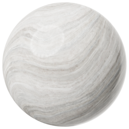</a> <b><a href="Onyx015">Onyx 015</a></b> by ambientCG · <a href="https://ambientcg.com/a/Onyx015">source</a> | <a href="Paint001">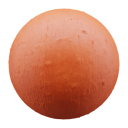</a> <b><a href="Paint001">Paint 001</a></b> by ambientCG · <a href="https://ambientcg.com/a/Paint001">source</a> | <a href="Paint002">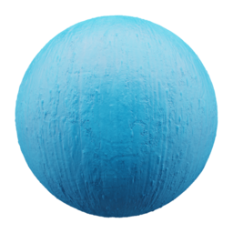</a> <b><a href="Paint002">Paint 002</a></b> by ambientCG · <a href="https://ambientcg.com/a/Paint002">source</a> | <a href="Paint003">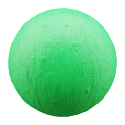</a> <b><a href="Paint003">Paint 003</a></b> by ambientCG · <a href="https://ambientcg.com/a/Paint003">source</a> |
| <a href="Paint004">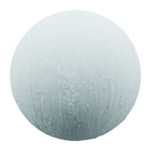</a> <b><a href="Paint004">Paint 004</a></b> by ambientCG · <a href="https://ambientcg.com/a/Paint004">source</a> | <a href="Paint005">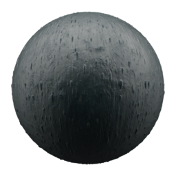</a> <b><a href="Paint005">Paint 005</a></b> by ambientCG · <a href="https://ambientcg.com/a/Paint005">source</a> | <a href="Paint006">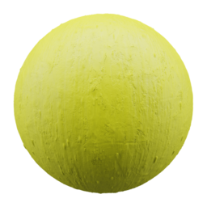</a> <b><a href="Paint006">Paint 006</a></b> by ambientCG · <a href="https://ambientcg.com/a/Paint006">source</a> | <a href="PaintedBricks001">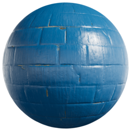</a> <b><a href="PaintedBricks001">Painted Bricks 001</a></b> by ambientCG · <a href="https://ambientcg.com/a/PaintedBricks001">source</a> |
| <a href="PaintedBricks002">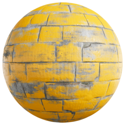</a> <b><a href="PaintedBricks002">Painted Bricks 002</a></b> by ambientCG · <a href="https://ambientcg.com/a/PaintedBricks002">source</a> | <a href="PaintedBricks003">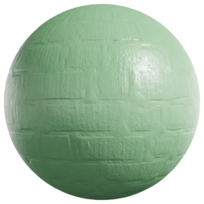</a> <b><a href="PaintedBricks003">Painted Bricks 003</a></b> by ambientCG · <a href="https://ambientcg.com/a/PaintedBricks003">source</a> | <a href="PaintedBricks004">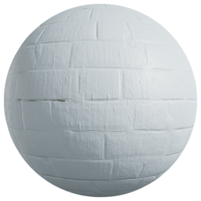</a> <b><a href="PaintedBricks004">Painted Bricks 004</a></b> by ambientCG · <a href="https://ambientcg.com/a/PaintedBricks004">source</a> | <a href="PaintedBricks005">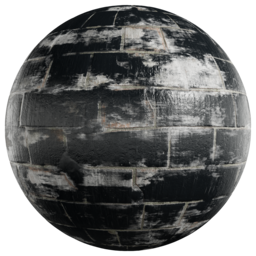</a> <b><a href="PaintedBricks005">Painted Bricks 005</a></b> by ambientCG · <a href="https://ambientcg.com/a/PaintedBricks005">source</a> |
| <a href="Painting001">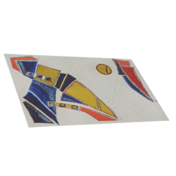</a> <b><a href="Painting001">Painting 001</a></b> by ambientCG · <a href="https://ambientcg.com/a/Painting001">source</a> | <a href="Paper001"></a> <b><a href="Paper001">Paper 001</a></b> by ambientCG · <a href="https://ambientcg.com/a/Paper001">source</a> | <a href="Paper002">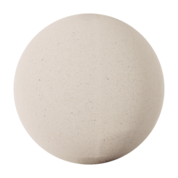</a> <b><a href="Paper002">Paper 002</a></b> by ambientCG · <a href="https://ambientcg.com/a/Paper002">source</a> | <a href="Paper003">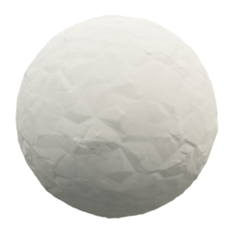</a> <b><a href="Paper003">Paper 003</a></b> by ambientCG · <a href="https://ambientcg.com/a/Paper003">source</a> |
| <a href="Paper004">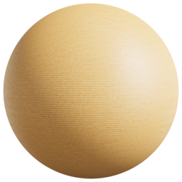</a> <b><a href="Paper004">Paper 004</a></b> by ambientCG · <a href="https://ambientcg.com/a/Paper004">source</a> | <a href="Paper005">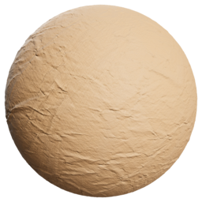</a> <b><a href="Paper005">Paper 005</a></b> by ambientCG · <a href="https://ambientcg.com/a/Paper005">source</a> | <a href="Paper006">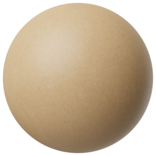</a> <b><a href="Paper006">Paper 006</a></b> by ambientCG · <a href="https://ambientcg.com/a/Paper006">source</a> | <a href="Pathway001">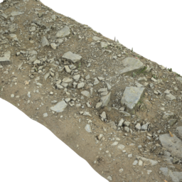</a> <b><a href="Pathway001">Pathway 001</a></b> by ambientCG · <a href="https://ambientcg.com/a/Pathway001">source</a> |
| <a href="Pathway002">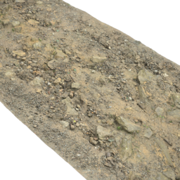</a> <b><a href="Pathway002">Pathway 002</a></b> by ambientCG · <a href="https://ambientcg.com/a/Pathway002">source</a> | <a href="Pathway003">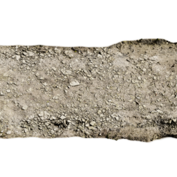</a> <b><a href="Pathway003">Pathway 003</a></b> by ambientCG · <a href="https://ambientcg.com/a/Pathway003">source</a> | <a href="Pathway004">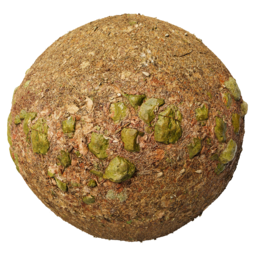</a> <b><a href="Pathway004">Pathway 004</a></b> by ambientCG · <a href="https://ambientcg.com/a/Pathway004">source</a> | <a href="PaymentCard001">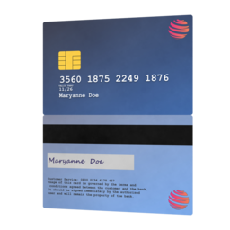</a> <b><a href="PaymentCard001">Payment Card 001</a></b> by ambientCG · <a href="https://ambientcg.com/a/PaymentCard001">source</a> |
| <a href="PaymentCard002">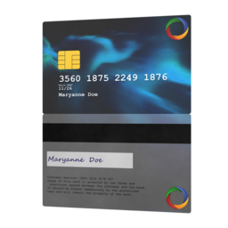</a> <b><a href="PaymentCard002">Payment Card 002</a></b> by ambientCG · <a href="https://ambientcg.com/a/PaymentCard002">source</a> | <a href="PaymentCard003">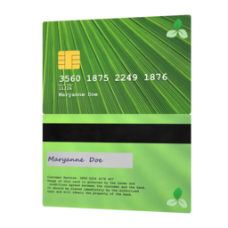</a> <b><a href="PaymentCard003">Payment Card 003</a></b> by ambientCG · <a href="https://ambientcg.com/a/PaymentCard003">source</a> | <a href="Pipe001">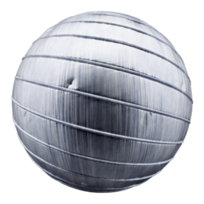</a> <b><a href="Pipe001">Pipe 001</a></b> by ambientCG · <a href="https://ambientcg.com/a/Pipe001">source</a> | <a href="Pipe002">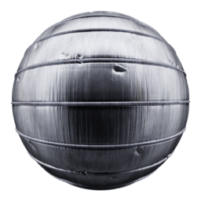</a> <b><a href="Pipe002">Pipe 002</a></b> by ambientCG · <a href="https://ambientcg.com/a/Pipe002">source</a> |
| <a href="Pipe003">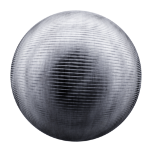</a> <b><a href="Pipe003">Pipe 003</a></b> by ambientCG · <a href="https://ambientcg.com/a/Pipe003">source</a> | <a href="Pipe004">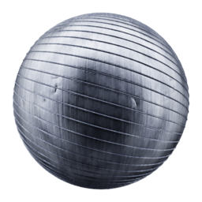</a> <b><a href="Pipe004">Pipe 004</a></b> by ambientCG · <a href="https://ambientcg.com/a/Pipe004">source</a> | <a href="Pizza001">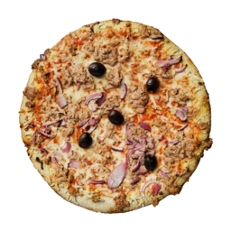</a> <b><a href="Pizza001">Pizza 001</a></b> by ambientCG · <a href="https://ambientcg.com/a/Pizza001">source</a> | <a href="Pizza002">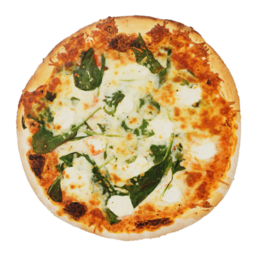</a> <b><a href="Pizza002">Pizza 002</a></b> by ambientCG · <a href="https://ambientcg.com/a/Pizza002">source</a> |
| <a href="Pizza003">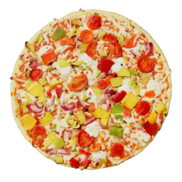</a> <b><a href="Pizza003">Pizza 003</a></b> by ambientCG · <a href="https://ambientcg.com/a/Pizza003">source</a> | <a href="Pizza004">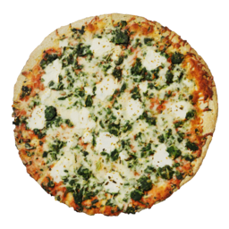</a> <b><a href="Pizza004">Pizza 004</a></b> by ambientCG · <a href="https://ambientcg.com/a/Pizza004">source</a> | <a href="Plaster001">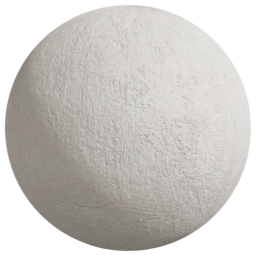</a> <b><a href="Plaster001">Plaster 001</a></b> by ambientCG · <a href="https://ambientcg.com/a/Plaster001">source</a> | <a href="Plaster002">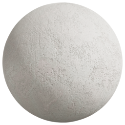</a> <b><a href="Plaster002">Plaster 002</a></b> by ambientCG · <a href="https://ambientcg.com/a/Plaster002">source</a> |
| <a href="Plaster003">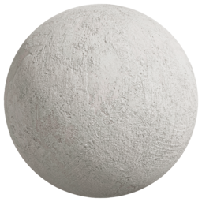</a> <b><a href="Plaster003">Plaster 003</a></b> by ambientCG · <a href="https://ambientcg.com/a/Plaster003">source</a> |  |  |  |

---

Kept up to date by this repository's own [update workflow](.github/workflows/update.yml), with code and plan from [cc0-mirror](https://github.com/zuujis-cc0/cc0-mirror). Something wrong? [Open an issue there](https://github.com/zuujis-cc0/cc0-mirror/issues/new) or use the [private report form](https://games.zuujis.com/report).
